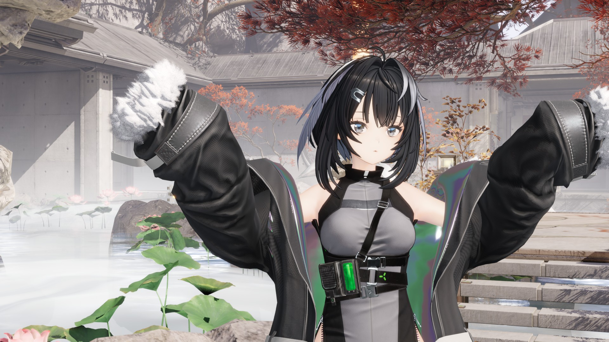

# Ruri-RipperHook

**一个面向跨引擎资产管线的 AOP Hook 框架:不改上游源码,把 AssetRipper、FModel 读到的各种游戏资产收敛成同一种干净的数据表示。**
不 fork 上游,不攒补丁集,新增数据来源不需要新工具。

```
游戏安装目录 ──▶ Ruri-RipperHook(本仓,读取器,C#)──▶ RuriRipperImporter(宿主插件)──▶ Blender / Substance Painter
```

---

## 作品展示

### 【终末地/模型配布】羽毛笔 恋愛サーキュレーション



原创模型,整条链路在 Blender 里完成:本仓读取终末地安装,由 [RuriRipperImporter](https://github.com/ShiyumeMeguri/RuriRipperImporter) 直接导入游戏场景(祀的家)、表情库、生成的着色栈与后处理,建好的角色放进场景里用 EEVEE 渲染出片。

**成片与模型配布:** [bilibili · BV1L44t6kEXz](https://www.bilibili.com/video/BV1L44t6kEXz)

### 打通建模工作流全链路:建模好直接导入终末地场景进行渲染


---

## 两个仓库,一条管线

| 仓库 | 角色 | 做什么 |
|---|---|---|
| **Ruri-RipperHook**(本仓) | 读取器 | AssetRipper / FModel 的 AOP 扩展层,认出游戏、读 CAB 依赖图、把网格骨架材质动画在内存里解成统一的数据集;插件下载的那份工具 DLL 就是它 |
| [**RuriRipperImporter**](https://github.com/ShiyumeMeguri/RuriRipperImporter) | 宿主插件 | Blender 与 Substance Painter 里的面板、导入、生成的着色栈、后处理、曝光渲染 |

插件指向游戏安装目录,经 cabmap 浏览资源并在内存里直接导入,把网格、真实骨架、材质与动画 clip 原样重建进 Blender:不经过 FBX 转换、不先导出 Unity 工程、不重新绑骨、不丢顶点流。游戏的差异全部在本仓解决:Unity 来源落成同一种 Unity 数据表示(YAML / Unity 对象语义),UE 来源以 `unreal.*` 数据集交付,插件只需要认识这一种形态。

---

## 主要能力

- **运行时 AOP**:Attribute 驱动的方法重定向,支持前置 / 后置 / 完全替换 / 构造拦截 / 完整 IL 重写。
- **导出流程接管**:可插入自定义 `IAssetProcessor`、覆写 `ExportCollection` 的产物路径与命名、跳过冗余处理阶段。
- **结构与格式适配**:对 Unity Bundle / SerializedFile / VFS / 流式资源等的解析点提供 Hook 切入位。
- **整个游戏一张依赖图**:cabmap 把安装当成一张 CAB 依赖图按需取用,大游戏按 bundle 粒度加载。
- **Shader 链路**:metadata 补全、绑定信息组织、DXBC / DXIL / SPIR-V bytecode 反编译,以及朝 Unity shader 表示形态的转换。
- **跨工具链统一**:FModel / UE 侧的数据不转 Unity 资产,以 `unreal.*` 数据集在内存里直接交给 Blender 插件。
- **GUI / CLI 双入口**:同一份 Hook 实现,GUI 用于交互式调试,CLI 用于批处理、脚本化导出与列表查询。

---

## 用它

| 操作 | 命令 / 路径 |
|---|---|
| 编译 | `dotnet build -c Debug --nologo`(整个解决方案;两个读取器共用输出目录,单编内核会把共享包覆盖回较窄版本) |
| 迭代时单编一个项目 | `dotnet build Source/Ruri.RipperHook/Ruri.RipperHook.csproj -c Debug --nologo`(交付前必须整编) |
| GUI 入口 | `Ruri.RipperHook.GUI.exe` |
| CLI 入口 | `Ruri.RipperHook.CLI.exe` |
| 列出可用 Hook | `Ruri.RipperHook.CLI.exe --list-hooks` |
| Headless 导出 | `Ruri.RipperHook.CLI.exe --hook <Id> --load <path> --export <dir>` |

只想在 Blender 里用的话不用自己编:RuriRipperImporter 的偏好设置里点 **Download / Update RipperHook** 会下载最新构建并把 Bin Dir 指过去。

游戏的 Unity 类型模型是运行时解释的 `RuriTypeTree.tpk`,不再有生成的 assembly;重打 tpk 用 `Ruri.Tpk`。Hot Reload 状态下偶发的 Hook 失效一般来自增量残留,重新触发编译可恢复。

---

## 它怎么工作

上游代码(AssetRipper、FModel)作为只读 submodule 冻结,差异化行为一律通过运行时方法 Hook 注入,而不是直接修改或 fork 上游。核心是一套基于 attribute 的 Hook 注册框架(`Ruri.Hook`),覆盖方法重定向、构造接管、IL 重写、引用计数与生命周期管理;在此之上,是一条把 FModel / UE 等异源工具链产出向统一数据模型靠拢的转换通路。

这种拆分的工程意义:上游升级时不需要 rebase 补丁集,新增数据来源不需要 fork 新工具,跨工具链共通的导出 / shader / 网格处理逻辑只在 Ruri 侧实现一次。

所有扩展都从一个继承 `RipperHookCommon` 的类开始,通过 `[RipperHook(...)]` 标注其适用范围,内部成员通过 attribute 描述要 hook 的目标方法:

```csharp
[RipperHook(...)]
public class MyHook : RipperHookCommon
{
    [RetargetMethod(typeof(TargetClass), nameof(TargetClass.TargetMethod),
                    isBefore: true, isReturn: false)]
    static void Patch(TargetClass self, /* original args */)
    {
        // prefix-continue logic
    }

    [RetargetMethodCtorFunc(typeof(SomeSettings))]
    static bool MutateDefaults(ILContext il) { /* IL rewrite */ return true; }
}
```

启动期 `Bootstrap.ApplyHooks(config)` 会发现所有匹配当前配置的 Hook 类,调用其 `Initialize()`,完成 attribute 扫描与方法重定向注册。整个生命周期由 `Ruri.Hook` 维护,业务代码不直接持有 MonoMod 句柄。

### 仓库结构

| 路径 | 职责 |
|---|---|
| `Source/Ruri.Hook` | AOP 框架本体:Attribute 定义、Hook 注册、方法重定向、反射工具 |
| `Source/Ruri.RipperHook` | AssetRipper 主增强层与内核:读取、导出、网格拆分、prefab 处理、路径修复、statement、cabmap、数据集 |
| `Source/Ruri.GameHook` | 每个游戏的黑盒(`Unity/`、`Unreal/`):游戏自己的表、名字、槽位、种子拼法都在这里,不进插件 |
| `Source/Ruri.RipperHook.GUI` | 图形界面入口(AssetRipper 流程) |
| `Source/Ruri.RipperHook.CLI` | 命令行入口,headless 导出与 Hook 列表查询 |
| `Source/Ruri.FModelHook` | FModel / UE 侧增强,shader bytecode 导出与统一 metadata 整理;`FModelHook/BlenderBridge/` 是 UE 解码器模块,宿主(CLI `--module` / GUI 配置 `Modules` / Blender 首选项)按路径或构建写下的 `Modules/*.module` 声明加载它,UE 包在内存里直接以 `unreal.*` 数据集交给 Blender 插件。依赖方向:FModelHook → RipperHook,内核不引用 CUE4Parse |
| `Source/Ruri.FModelHook.GUI` | FModel 流程的图形界面入口 |
| `Source/Ruri.FModelHook.CLI` | FModel 流程的无头命令行入口,挂载游戏并导出 / 反编译 shader |
| `Source/Ruri.ShaderDecompiler` | DXBC / DXIL / SPIR-V shader 反编译实现 |
| `Source/Ruri.Tpk` | 把 TypeTree JSON 打包成 `RuriTypeTree.tpk`(Ruri.RipperHook 的内嵌资源);UE lane(`Unreal/`,与 Unity lane 隔离):`--unreal <usmap>` 把 UE 反射 schema 直出为自定义引擎 tpk |
| `Source/Ruri.UEShaderTpkDumper` | 直接解析 UE 引擎源码,按引擎版本导出 uniform buffer 布局种子到 `Ruri.FModelHook/EngineUbMetadata` |
| `Source/Ruri.ACL` | ACL 压缩动画数据的解码 |
| `AssetRipper/`, `FModel/` | 上游 submodule,**只读冻结**,差异通过 Hook 注入而非直接修改 |

---

## 适用场景

- 为 Blender / MMD 等 3D 内容创作与技术美术研究流程准备干净、可直接导入的资产(网格、材质、骨架、动画)。
- 给已有数据管线工具链补齐读取或导出短板,而不想直接 fork。
- 把零散的导出流程修补整理为可组合、可复用的模块。
- 在多个工具之间共用一套 shader / 网格 / prefab 处理逻辑。
- 需要在上游频繁升级的同时维护稳定的差异化行为。

---

## 给要改代码的人

内核约束见 [CLAUDE.md](CLAUDE.md);框架事实与坑(hook 写法、AssetRipper 内部数据流、路径、processor 注入、类型树、CAB 映射、UE 读取等)见 [FRAMEWORK.md](FRAMEWORK.md);插件那边的层界与规矩见 [RuriRipperImporter](https://github.com/ShiyumeMeguri/RuriRipperImporter) 的 CLAUDE.md。

---

## Special Thanks

- **ds5678** — AssetRipper original author
- **AnimeStudio**
- **nesrak1** — USCSandbox author
- **Razmoth**
